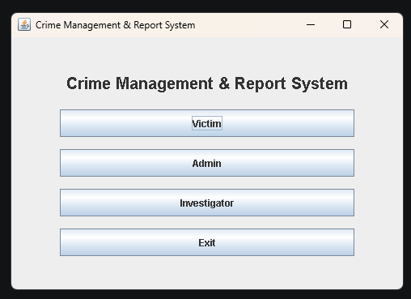
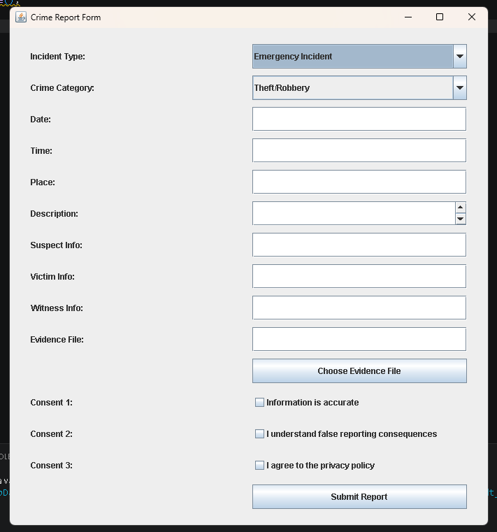
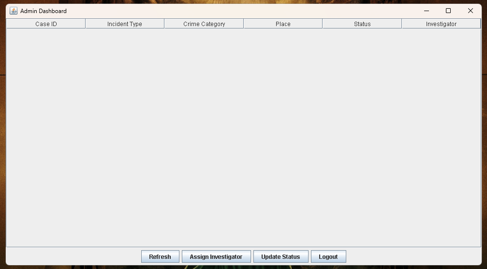
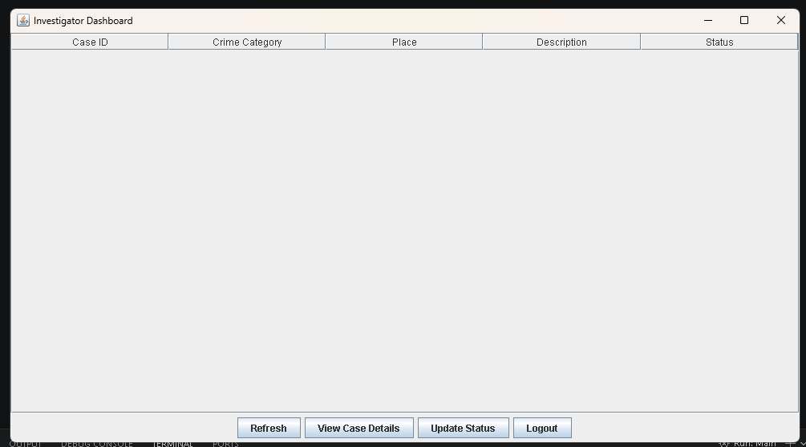

<h1 align="center">✦ Crime Investigation Portal ✦</h1>

<p align="center">
  <strong>A Java Swing desktop application for fictional crime-report workflows.</strong><br />
  <sub>Academic prototype · Multi-role interface · Local file storage</sub>
</p>

<p align="center">
  
  
  
  
</p>

<p align="center">
  <a href="#-overview">Overview</a> ·
  <a href="#-features">Features</a> ·
  <a href="#-application-screenshots">Screenshots</a> ·
  <a href="#-getting-started">Getting Started</a> ·
  <a href="#-limitations--future-improvements">Limitations</a>
</p>

---

## ✦ Overview

**Crime Investigation Portal** is a desktop prototype created with **Java and Swing**. It models the reporting and management of fictional incidents through separate **victim, administrator, and investigator** interfaces.

The project focuses on object-oriented design, GUI event handling, case records, and local file operations. It is **not** connected to police, emergency services, or a production system.

## ◈ Features

| Interface | Functionality |
| --- | --- |
| **Welcome screen** | Navigate between victim, admin, and investigator sections |
| **Victim** | Complete an incident report form and receive a generated case ID |
| **Admin** | View reports, assign investigators, and update case status |
| **Investigator** | View assigned cases, inspect case details, and update status |
| **Case tracking** | Look up reports through the case-tracking interface |
| **Persistence** | Save and load records using local text files |

The report form includes incident and crime categories, date/time, location, description, additional case details, an evidence-file path selector, and confirmation checkboxes.

## ▣ Application Screenshots

<p align="center">
  
  <br />
  <sub>01 / Welcome Screen</sub>
</p>

<p align="center">
  
  <br />
  <sub>02 / Crime Report Form</sub>
</p>

<details>
<summary><strong>✦ View the Admin & Investigator Dashboards</strong></summary>

<p align="center">
  
  <br />
  <sub>03 / Administrator Dashboard</sub>
</p>

<p align="center">
  
  <br />
  <sub>04 / Investigator Dashboard</sub>
</p>

</details>

## 🛠 Technologies & Concepts

<p>
  
</p>

- **Language:** Java
- **GUI:** Java Swing
- **Development environments:** IntelliJ IDEA / VS Code with Java support
- **Core concepts:** OOP, classes, event handling, multi-window UI flows, and file I/O
- **Data:** Local `reports.txt` file; no remote database

## ⌘ Getting Started

### Requirements

- Java Development Kit (JDK), with `java` and `javac` available
- A desktop operating system with GUI support

### Compile and run

Open a terminal in the directory containing `Main.java` and the other source files.

```bash
javac *.java
java Main
```

Alternatively, open the source files in **IntelliJ IDEA** or **VS Code** and run `Main.java`.

### Basic workflow

1. Launch the application and choose a role.
2. As a **Victim**, create a fictional test report.
3. As an **Admin**, view the report and assign an investigator.
4. As an **Investigator**, view assigned cases and update their status.
5. Use the case-tracking interface to look up case information.

Use fictional information. Demo login credentials are hardcoded in the source and are not secure authentication.

## ▣ Project Structure

```text
crime-investigation-portal-java/
├── Main.java
├── WelcomeFrame.java
├── VictimDashboard.java
├── CrimeReportForm.java
├── CrimeReport.java
├── ReportService.java
├── CaseTrackingFrame.java
├── AdminLoginFrame.java
├── AdminDashboard.java
├── InvestigatorLoginFrame.java
├── InvestigatorDashboard.java
├── screenshots/
│   ├── welcome-screen.png
│   ├── crime-report-form.png
│   ├── admin-dashboard.png
│   └── investigator-dashboard.png
├── .gitignore
└── README.md
```

## ✧ What I Practiced

- Designing forms and dashboards with Swing
- Building event-driven interactions
- Organizing application flows into Java classes
- Modeling and updating report records
- Reading and writing local data files
- Documenting interface behavior with screenshots

## ⚠ Limitations & Future Improvements

- **No real emergency notification:** Submitting an emergency-type report does not contact emergency services.
- **No evidence transfer:** Selecting evidence records a local path; it does not upload or securely store the file.
- **Demo authentication:** Hardcoded credentials are not suitable for real users.
- **Local-only storage:** There is no shared database or online synchronization.
- **Basic identifiers and validation:** Timestamp-based case IDs may collide and form validation is limited.

This application is an **academic prototype**, not an official incident-reporting platform. Do not enter real reports or sensitive personal information.

Potential next steps: secure authentication, proper evidence storage, a database, stronger input validation, collision-resistant IDs, and automated tests.

---

<p align="center">
  <a href="https://github.com/saimumfahad-dev">GitHub Profile</a> ·
  <a href="https://github.com/saimumfahad-dev/bank-management-system-c">C Project</a> ·
  <a href="https://www.linkedin.com/in/md-saimum-islam-fahad/">LinkedIn</a>
  <br />
  <sub>✦ Code · Build · Learn ✦</sub>
</p>
